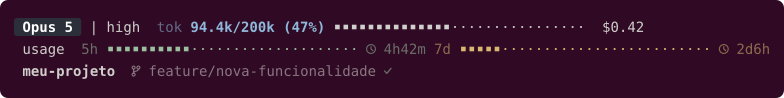

# 🛩️ cockpit-nav

Minha statusline do [Claude Code](https://claude.com/claude-code) e [Antigravity CLI](https://antigravity.google) no Ubuntu.

Mostra em 3 linhas o que eu preciso sem sair do terminal: modelo e esforço,
contexto já usado, custo da sessão, os limites de 5h e 7 dias **com o tempo que
falta pra resetar**, e a pasta e branch onde estou.



## Como usar

Precisa de `jq`, `node` ou `python3` pra ler o JSON (qualquer um serve), e de uma
[Nerd Font](https://www.nerdfonts.com/font-downloads) pros ícones de branch e relógio.

### Claude Code

```bash
cp statusline.sh ~/.claude/statusline.sh && chmod +x ~/.claude/statusline.sh
```

Adicione no `~/.claude/settings.json` e reinicie o Claude Code:

```json
"statusLine": { "type": "command", "command": "/home/SEU_USUARIO/.claude/statusline.sh" }
```

### Antigravity CLI (`agy`)

```bash
cp statusline.sh ~/.gemini/antigravity-cli/statusline.sh && chmod +x ~/.gemini/antigravity-cli/statusline.sh
```

Adicione no `~/.gemini/antigravity-cli/settings.json`:

```json
"statusLine": {
  "type": "command",
  "command": "/home/SEU_USUARIO/.gemini/antigravity-cli/statusline.sh"
}
```

Ou configure direto dentro do CLI interativo:
```text
/statusline /home/SEU_USUARIO/.gemini/antigravity-cli/statusline.sh
```

### Customização

Dá pra ajustar largura da barra, glifos e ícones por variável de ambiente — está
comentado no topo do `statusline.sh`.

## Referências

Merge de duas statuslines da comunidade do [statusline.sh](https://statusline.sh/):

- [Cockpit](https://statusline.sh/community/cockpit-4shq), de RX — todo o visual
- [Minimalist (fork)(fork)(fork)](https://statusline.sh/community/minimalist-fork-fork-fork-yv5B), de hieu — diretório, branch e tempo de reset

## Licença

MIT
